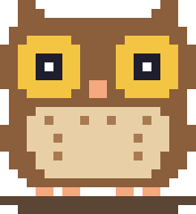

<p align="center">
  
</p>

# :owl: nvim.init

A Neovim 0.12 config: lazy.nvim, native LSP, blink.cmp, snacks.nvim. Runs on macOS, Linux and a Raspberry Pi.

See **[Docs](https://venkat-rajgopal.github.io/nvim.init/)** for usage and configuration details. 

## Quick start

Needs Neovim 0.12+, `git`, a C compiler, `tree-sitter-cli`, `ripgrep`, Node.js 22+ and a [Nerd Font](https://www.nerdfonts.com/) (v3).

```shell
# macOS
brew install neovim tree-sitter-cli ripgrep node
git clone https://github.com/Venkat-Rajgopal/nvim.init.git ~/.config/nvim

# Debian, Ubuntu, Raspberry Pi OS: installs whatever is missing
git clone https://github.com/Venkat-Rajgopal/nvim.init.git ~/.config/nvim
~/.config/nvim/install.sh
```

Start `nvim`; plugins, parsers and language servers install on the first start. `<leader>` is `Space`: press it and wait to see every key.

## Docs

The site lives in [`docs/`](docs) (`VitePress`). Reference pages are generated by `docs/scripts/generate.lua` from the running config, so don't edit them; give new keymaps a `desc` and they show up. To preview:

```shell
cd docs && npm install && npm run docs:dev
```
